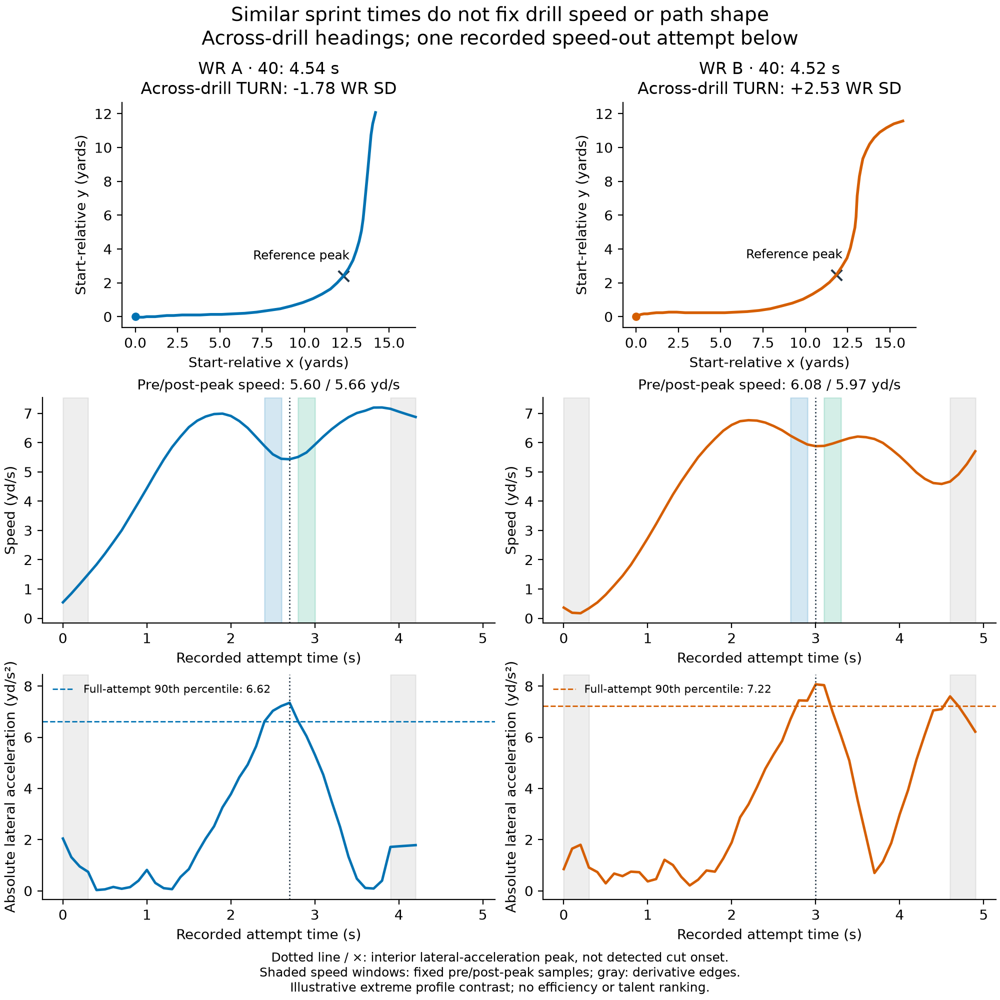
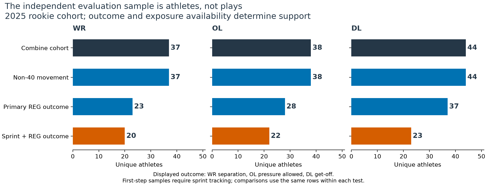
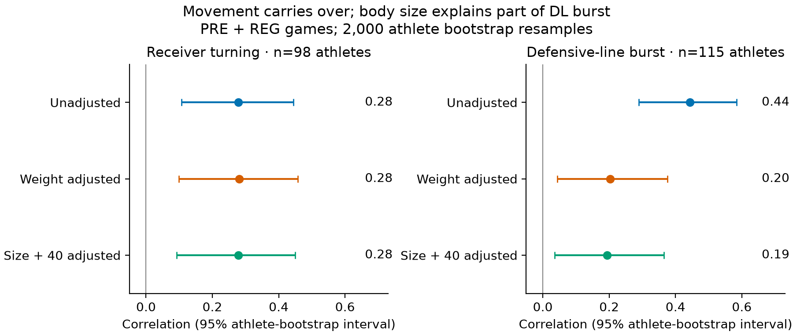
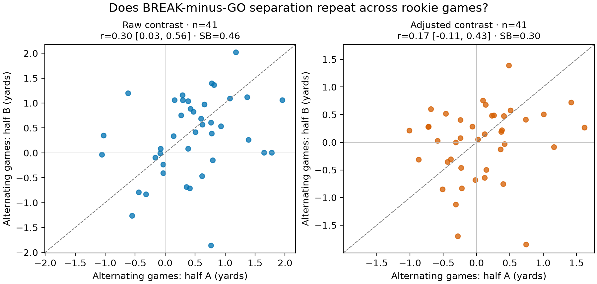
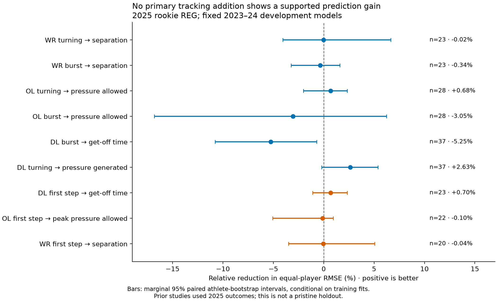
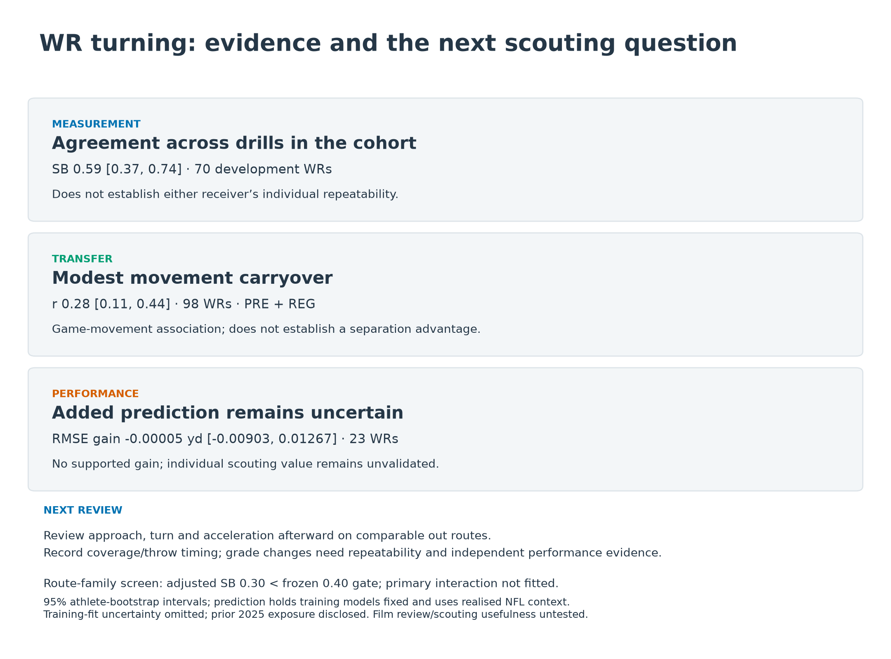

Receiver A ran an observed 4.54-second 40; Receiver B ran 4.52. Their sprint times are close, yet their Combine turning profiles differ. Does that extra movement information justify a different scouting evaluation?

For 23 evaluation receivers, adding TURN to conventional measurables, draft information and NFL context changed athlete-mean separation prediction error from 0.23572 to 0.23577 yards. The uncertainty interval did not support improvement. Across all nine prescribed receiver and line comparisons, none of the primary intervals supported improved prediction.

We propose using movement differences to focus a specific film question: how does each receiver approach and exit comparable out cuts? A recommendation would require repeatable individual measurements and further performance evidence. This film-review use has not been tested in scouting.

Our evidence map separates three questions: **can we measure movement consistently, does it carry into games, and does it improve regular-season performance prediction?**

*Figure 1. Headings summarize across-drill TURN; each column shows one speed-out attempt. Selection maximized TURN contrast among 2023–24 WRs with observed 40 times within 0.03 seconds, deterministic ties and first recorded attempts. No NFL outcomes selected this extreme example. Crosses/dotted lines mark interior acceleration peaks; colored speed windows are descriptive, and gray shading marks derivative edges.*

## What tracking adds to the stopwatch

The competition data contain 510 athletes, 22.65 million game-tracking frames and 314,197 player-play records. Player IDs connect Combine tracking, conventional tests, draft information and supplied NFL performance/context fields. Key, count and join checks are reproducible.

Tracking runs at 10 Hz. Seven-sample quadratic smoothing derives acceleration along and perpendicular to travel. **TURN** is an attempt's 90th percentile of absolute lateral acceleration; **BURST** is peak longitudinal acceleration. We average attempts within athlete/drill, standardize within drill, then average available non-40 drills. **A0** estimates initial acceleration from a fitted 40-yard speed curve.

Lateral acceleration depends on speed and path curvature. At Figure 1's separately selected reference peaks, B moves faster (5.879 versus 5.433 yd/s) along a slightly wider local curve (curvature 0.233 versus 0.249 1/yd). A higher value does not establish more efficient cutting. Both profiles use 13 drills; the displayed speed-out contributes 5.9% arithmetically to the composite gap. One attempt does not explain the whole profile. Peak/window rules were written before these descriptive calculations.

Game movement uses the same decomposition, calculated on complete player tracks before restricting to the first three seconds after snap. Movement transfer pools preseason and regular season, excluding postseason. Performance uses regular season and excludes nullified plays.

Game coordinates cover rookie-cohort players without opponent/ball geometry. Receiver separation is supplied distance to the nearest defender at throw. Line outcomes include snap-to-LOS-crossing get-off time, pressure allowed, peak pressure probability allowed and an operational pressure flag based on recorded time-to-pressure presence. These are not independently reconstructed outcomes.

*Figure 2. Exposure and outcome availability determine the sample. Thousands of plays can improve an athlete's mean estimate; they do not create thousands of independent prospects.*

## How we tested NFL relevance

Historical association models examine available regular-season observations with player intercepts and conventional controls: draft slot, undrafted status, size, 40 time, season and relevant supplied football context. Receiver controls include route, coverage, alignment, cushion and motion.

The historical audit uses two-sided inference and Holm correction within six movement and three first-step tests. Recorded expected directions had not specified a one-sided threshold. First-step scaling uses unique athletes; binary outcomes also receive a player-clustered linear-probability sensitivity. Original reports and the correction record remain available.

Prediction asks a separate question. We train on 2023–24 rookie regular seasons and evaluate 2025 rookie regular seasons. Drill references, imputation, scaling and context encoding use training athletes. Baseline and tracking models use identical rows; first-step baselines also include the 10-yard split. All 25 primary, secondary and cone-subset pairs are frozen before scoring.

Fixed predictions exclude evaluation-player intercepts and recalibration. Outcomes and predictions are averaged within athlete over realised NFL contexts; each athlete has equal weight in root mean squared error (RMSE). **Gain = baseline RMSE − tracking RMSE**; positive means lower prediction error. Paired athlete bootstraps give 95% intervals, with simultaneous intervals for the original six/three families. Binary prediction uses an unclipped linear-probability model, not a calibrated probability forecast.

These are retrospective conditional comparisons, not draft-time forecasts of future roles. Earlier studies already used 2025 outcomes, so this is not a pristine holdout. Intervals hold trained models fixed and omit training-fit uncertainty. The latest trained calendar intercept is assumed to persist into 2025.

## Movement carries over, with limits

Development-WR cross-drill TURN consistency is Spearman–Brown 0.593 [0.373, 0.737], n=70. This cohort agreement does not establish either example player's repeatability. The separate speed-out repeat correlation is 0.012 [−0.442, 0.492], only 17 pairs, and remains highly uncertain.

WR turning transfers modestly into game movement: r=0.279 [0.107, 0.445], n=98. After measured size/40 adjustment, r=0.278 [0.092, 0.450]. DL burst transfer is 0.443 [0.289, 0.584], n=115, falling to 0.203 [0.044, 0.376] after weight adjustment. Adjustment refits within athlete bootstraps. These are movement associations, not performance advantages. Historical full-cohort normalization differs from development reliability and training-only prediction.

*Figure 3. Pooled PRE+REG movement correlations do not establish added performance prediction or a causal training benefit.*

A registered receiver follow-up asked whether TURN relates to separation on pooled SLANT/OUT relative to GO. Before fitting that interaction, the adjusted route-family separation contrast had to repeat across alternating games. Support was 42 development receivers and 16 evaluation receivers; 41 supported the diagnostic halves.

Adjusted consistency was 0.296 [−0.257, 0.606], below the frozen 0.40 gate; raw consistency was 0.463. We stopped the primary interaction and Study 3 evaluation without changing thresholds or route groups. This does not prove every route-specific relationship is zero. Shared baseline adjustment across halves is an additional limitation.

*Figure 4. BREAK pools SLANT/OUT; panel intervals describe correlations. The gate failed before fitting a TURN interaction. Throw-time separation is not separation caused specifically by a break.*

## Added performance prediction remains uncertain

Historical associations contain 0/9 two-sided Holm-significant original results and 0/3 in the separate binary sensitivity. Prediction has three positive and six negative primary point gains; none has a marginal interval supporting improvement. All original-family simultaneous intervals include zero. Primary samples contain 20–37 athletes.

For WR TURN, baseline RMSE is 0.23572 yards versus 0.23577 with tracking, n=23. Both round to 0.24 yards, but that does not establish equivalence. The gain interval [−0.00903, +0.01267] yards permits higher and lower prediction error. It concerns athlete-mean predictions, rather than actual separation changes or individual-route errors. W1 pools eligible routes and does not directly answer the out-cut film question.

The 3,701 WR plays range from two to 401 per athlete, median 162. Equal weighting does not eliminate noisy low-exposure means. The prespecified ≥30-play check retains 17 WRs and remains uncertain. DL burst worsens get-off prediction nominally; its family and ≥30-play intervals include zero. F2's ≥30-play nominal result is also adverse, with its family interval including zero.

*Figure 5. Positive is better. Relative RMSE reductions and intervals condition on training fits. Table 1 supplies absolute errors and units.*

<!-- EVALUATION_TABLE -->

| Comparison | Unit | Athletes | Baseline RMSE | + Tracking RMSE | RMSE gain [95% interval] |
|---|---|---:|---:|---:|---:|
| WR turning / separation | yd | 23 | 0.23572 | 0.23577 | -0.00005 [-0.00903, 0.01267] |
| WR burst / separation | yd | 23 | 0.23572 | 0.23651 | -0.00079 [-0.00641, 0.00416] |
| OL turning / pressure allowed | proportion | 28 | 0.09511 | 0.09446 | +0.00065 [-0.00114, 0.00171] |
| OL burst / pressure allowed | proportion | 28 | 0.09511 | 0.09800 | -0.00290 [-0.00728, 0.00382] |
| DL burst / get-off time | s | 37 | 0.07583 | 0.07981 | -0.00398 [-0.00705, -0.00049] |
| DL turning / pressure generated | proportion | 37 | 0.04370 | 0.04255 | +0.00115 [-0.00008, 0.00231] |
| DL first step / get-off time | s | 23 | 0.09281 | 0.09216 | +0.00065 [-0.00086, 0.00195] |
| OL first step / peak pressure allowed | proportion | 22 | 0.09364 | 0.09373 | -0.00009 [-0.00181, 0.00066] |
| WR first step / separation | yd | 20 | 0.21054 | 0.21062 | -0.00008 [-0.00779, 0.00875] |

*Table 1. Equal-athlete RMSE; positive gain is better. Marginal 95% intervals condition on training fits; all original-family simultaneous intervals include zero.*

<!-- END_EVALUATION_TABLE -->

Selected cone findings remain secondary. DL A0 improves get-off RMSE by 0.00755 seconds [0.00443, 0.01080] on nine athletes; its broader primary is uncertain. The historical DL TURN/pressure cone association is positive, with uncertain cone prediction. W2_cone deteriorates on seven WRs. The notebook retains all 16 secondary comparisons; missing cone times are not imputed.

Unsupported gains do not establish equivalence or that tracking is useless. They limit conclusions for these measurements, baselines and samples.

## A concrete scouting conversation

A's and B's profiles are −1.78 and +2.53 development-WR standard deviations. Inspect their paths and speeds alongside the multi-drill profiles, then request film of comparable out routes.

**Proposed film question:** how does each receiver approach the break, change direction and build speed afterward? Record route direction/depth, alignment, motion, coverage, cushion and quarterback release timing. Define eligible clips before viewing their results; retain unsuccessful, untargeted and contradictory eligible routes. Separate visible observations from interpretations and missing context. No film assessment was performed here.

The meeting produces a question and an evidence gap. A TURN-based grade change needs repeatable individual measurements and independently supported NFL performance information beyond conventional evaluation. Neither the cohort movement association nor W1 supplies that evidence for these two players. No individual change threshold or benefit from training TURN is established.

*Figure 6. A proposed workflow: observe movement, ask a specific film question and record the evidence needed before changing a recommendation. Cohort agreement, movement transfer and added prediction remain separate.*

Small evaluation samples, playing-time/cone selection, missing opponent geometry, observational context and numerical boundary fits remain limitations. The notebook rebuilds features, audits, frozen evaluation, sensitivities and visuals from competition CSVs, including twelve pipeline tests and four movement-physics checks. Scouting decision usefulness remains untested.

Data and attribution: [NFL Big Data Bowl 2027 competition data](https://www.kaggle.com/competitions/nfl-big-data-bowl-2027/data), NFL; CC BY-NC 4.0. Protocols, filters, diagnostics and all secondary findings appear in the [attached reproducible notebook](https://www.kaggle.com/code/oppenheimer6th/combine-movement-to-nfl-decisions-an-evidence-map).
