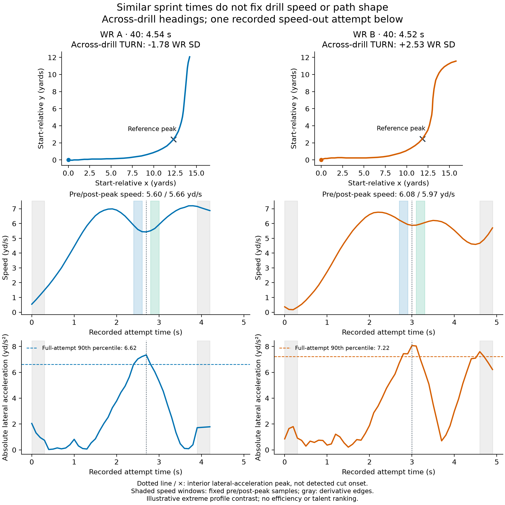
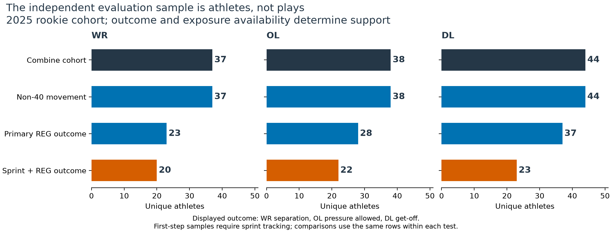
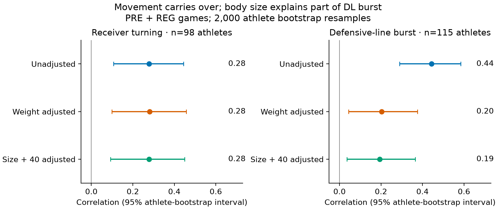
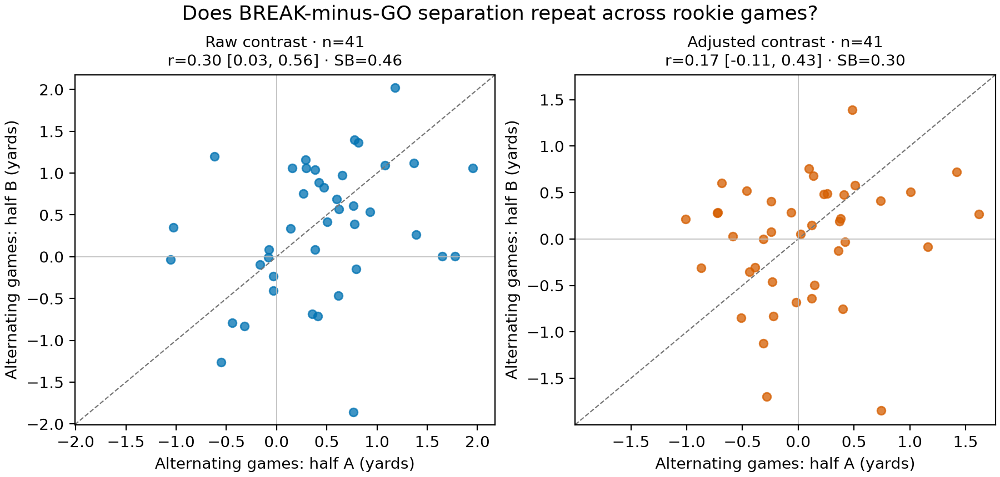
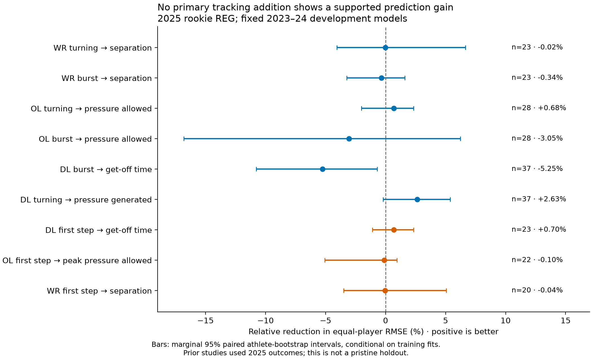
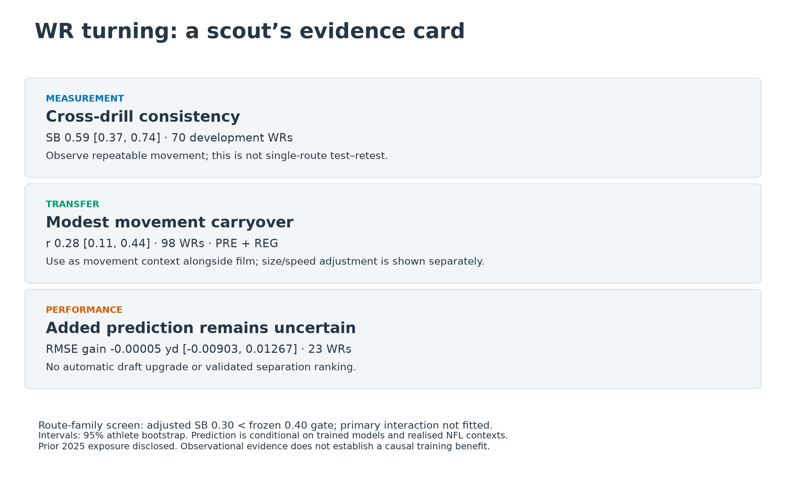

# From Combine Movement to NFL Decisions: An Evidence Map

A prospect can post a familiar 40-yard time while moving very differently through a football drill. That makes Combine tracking attractive: it describes how an athlete moves, rather than only when an athlete finishes. But does the additional detail improve an NFL performance decision?

Across nine prescribed comparisons for receivers and offensive and defensive linemen, adding our tracking traits did not produce a cohort prediction gain supported by a primary 95% interval. Some movement transferred from the Combine to games. The distinction matters: movement evidence and performance evidence answer different scouting questions.

We build an evidence map that keeps three questions separate: **Can we measure it consistently? Does it carry into games? Does it add performance information beyond conventional measurables?** The result is a calibrated scouting aid, with uncertainty visible at each step.

*Figure 1. The pair was chosen using Combine exposures only: observed 40 times within 0.03 seconds, largest training-reference TURN difference, deterministic ties. Paths are translated to their starts. These examples illustrate measurement; they make no NFL-success comparison.*

## What we measured

The supplied competition data contain 510 athletes, 22.65 million game-tracking frames and 314,197 player-play records. We connect player IDs across Combine tracking, conventional test results, draft information, game tracking and supplied performance fields. Key, count and join checks are reproducible in the notebook.

Tracking runs at 10 Hz. We smooth positions and derive acceleration along and perpendicular to the direction of travel. This distinguishes speeding up from turning; the supplied total-acceleration magnitude does not distinguish those components. **TURN** is an attempt's 90th percentile of absolute lateral acceleration. **BURST** is peak longitudinal acceleration. We average attempts within athlete and drill, standardise within drill, then average across non-40 drills. This reduces differences caused by athletes completing different drill mixes.

Our second exposure, **A0**, estimates initial acceleration from a fitted 40-yard speed curve. It represents a separate first-step hypothesis. High lateral acceleration depends on both speed and path shape; none of these measures is automatically an intrinsic, trainable ability score.

Game movement uses the same decomposition, calculated on complete player tracks before restricting to the first three seconds after the snap. Movement-transfer analyses include preseason and regular season, explicitly excluding postseason. Performance analyses use regular season and exclude nullified plays.

The tracking contains rookie-cohort players rather than a full set of opponents and the ball. We therefore use the supplied performance/context fields and do not reconstruct defender leverage or separation trajectories. Receiver performance is the supplied separation-at-pass-forward field; line outcomes include get-off, pressure allowed, peak pressure probability allowed and an operational pressure flag based on recorded time-to-pressure presence.

*Figure 2. Exposure and outcome availability determine the evaluation sample. Thousands of plays improve an athlete's outcome estimate; they do not create thousands of independent prospects.*

## How we tested added value

Historical association models examine all available regular-season observations. Conventional controls include draft slot, undrafted status, body size, 40 time, season and football context. Receiver models account for route, coverage, alignment, cushion and motion; line models use the relevant supplied context. Player intercepts account for repeated observations.

We audited the six movement-envelope tests and three first-step tests. Expected directions had been recorded, but a one-sided significance threshold was not explicit. The audit therefore uses conservative two-sided inference and Holm correction within the original six- and three-test families. First-step scaling now uses unique athletes rather than weighting their exposure distributions by play count. Binary historical models also have a separately labelled player-clustered linear-probability sensitivity. Original reports and the correction record remain available.

Prediction asks a different question. We train on 2023–24 rookie regular seasons and evaluate 2025 rookie regular seasons. Drill references, player medians, scaling and context encoding are learned from training data. Every baseline and tracking-augmented model uses identical rows; the first-step baseline also includes the 10-yard split. All 25 primary, secondary and cone-subset pairs are frozen before scoring.

We predict with fixed model components only: evaluation outcomes cannot supply player intercepts or recalibration. For each athlete, we average the observed outcome and prediction over that athlete's realised NFL contexts. Each athlete contributes equally to root mean squared error (RMSE). Positive baseline-minus-tracking RMSE means improvement. Paired athlete bootstraps give marginal 95% intervals; simultaneous intervals address the original six/three comparison families.

These are retrospective, conditional predictions. They do not forecast a prospect's future route tree or playing opportunity. Earlier studies already used 2025 outcomes, so this is **not a pristine untouched holdout**. Bootstrap intervals condition on fitted training models and omit training-fit uncertainty. We also disclose the assumption that the latest trained calendar intercept persists into 2025.

Equal-athlete scoring prevents a high-volume starter from dominating the evaluation, but low exposure still makes some athlete means noisy. The WR TURN sample ranges from two to 401 valid plays per athlete, with a median of 162. We retain the complete primary sample and report the already specified at-least-30-play sensitivity separately; we do not choose the threshold that makes tracking look best. The latter WR sample has 17 athletes and still has an uncertain prediction gain.

## Movement carries over, with limits

For 70 development receivers, training-reference TURN has cross-drill Spearman–Brown consistency of 0.59, with a 95% interval of 0.37–0.74. This describes agreement across different drills, not repeatability of one route-specific talent score. Only three receivers repeated the tracked slant drill, which limits a slant-specific interpretation.

Receiver turning transfers modestly to game movement: correlation 0.279 [0.107, 0.445], 98 athletes. Defensive-line burst transfer is stronger before adjustment: 0.443 [0.289, 0.584], 115 athletes. After controlling for weight, that DL correlation falls to 0.203 [0.044, 0.376]. Body size explains part of the apparent carryover. Adjustment refits within each athlete bootstrap; the figure also shows size-plus-40 adjustment.

*Figure 3. These pooled-season movement correlations are descriptive. They establish neither added performance prediction nor a causal benefit from training the trait.*

We also registered a bounded receiver follow-up: whether TURN relates to separation on pooled SLANT/OUT routes relative to GO. Before fitting that interaction, we required the adjusted route-family separation contrast to repeat across alternating games. There were 42 eligible development receivers and 16 evaluation receivers; 41 supported the diagnostic halves.

The adjusted contrast's Spearman–Brown estimate was 0.296 [−0.257, 0.606], below the frozen 0.40 gate. Raw contrast consistency was 0.463. We stopped the primary interaction without weakening the threshold or changing route groups. The wide interval does not prove every route-specific relationship is zero. It means this measurement did not support the planned primary claim. Shared baseline adjustment across halves is an additional limitation.

*Figure 4. The gate failed before a TURN interaction was fitted. Separation at a shared pass-forward event should not be interpreted as separation caused specifically by a receiver's break.*

## Added performance prediction remains uncertain

The audited original association families contain zero Holm-significant results among nine tests. The three player-clustered binary sensitivities also contain none. Cohort prediction is consistent with a cautious conclusion: three primary point gains are positive and six negative, but none has a marginal interval supporting improvement. All original-family simultaneous intervals include zero. Primary evaluation samples contain 20–37 athletes.

For WR TURN, baseline separation RMSE is 0.23572 yards versus 0.23577 with tracking: effectively no point improvement, with a gain interval of [−0.00903, 0.01267] yards across 23 receivers. DL TURN has a small positive pressure-generation point gain, but its interval includes zero. DL BURST worsens get-off prediction nominally; its family-adjusted and at-least-30-play sensitivity intervals remain uncertain. We retain favourable and adverse results together.

*Figure 5. Positive is better. Bars show relative reductions in equal-athlete RMSE, conditional on training fits. The table supplies absolute errors and units.*

<!-- EVALUATION_TABLE -->

| Comparison | Unit | Athletes | Baseline RMSE | + Tracking RMSE | RMSE gain [95% interval] |
|---|---|---:|---:|---:|---:|
| WR turning / separation | yd | 23 | 0.23572 | 0.23577 | -0.00005 [-0.00903, 0.01267] |
| WR burst / separation | yd | 23 | 0.23572 | 0.23651 | -0.00079 [-0.00641, 0.00416] |
| OL turning / pressure allowed | proportion | 28 | 0.09511 | 0.09446 | +0.00065 [-0.00114, 0.00171] |
| OL burst / pressure allowed | proportion | 28 | 0.09511 | 0.09800 | -0.00290 [-0.00728, 0.00382] |
| DL burst / get-off time | s | 37 | 0.07583 | 0.07981 | -0.00398 [-0.00705, -0.00049] |
| DL turning / pressure generated | proportion | 37 | 0.04370 | 0.04255 | +0.00115 [-0.00008, 0.00231] |
| DL first step / get-off time | s | 23 | 0.09281 | 0.09216 | +0.00065 [-0.00086, 0.00195] |
| OL first step / peak pressure allowed | proportion | 22 | 0.09364 | 0.09373 | -0.00009 [-0.00181, 0.00066] |
| WR first step / separation | yd | 20 | 0.21054 | 0.21062 | -0.00008 [-0.00779, 0.00875] |

*Table 1. Equal-athlete RMSE; positive gain is better. Marginal 95% intervals condition on training fits; all original-family simultaneous intervals include zero.*

<!-- END_EVALUATION_TABLE -->

Cone checks retain two interesting exceptions. The historical DL TURN pressure association remains positive after cone adjustment, but its cone-subset cohort prediction is uncertain. DL A0 improves get-off RMSE by 0.00755 seconds [0.00443, 0.01080] in a cone-observed evaluation subset of **nine athletes**. This is one of nine cone sensitivities, in a selected sample, while the broader primary first-step comparison remains uncertain. Other subset findings include adverse prediction results. No cone times are invented, and the notebook reports every comparison.

Absence of a supported gain does not establish equivalence, negligible effects or that all tracking features are useless. It limits the claims justified by these particular traits, models and samples.

## What a scout can do with this

Use the evidence card to distinguish a movement observation from a performance recommendation. A receiver with repeatable TURN warrants a concrete film question: how does the observed movement appear in relevant football situations? A modest transfer correlation adds context. It does not independently justify moving that receiver up a draft board or calling the athlete a hidden star.

The three fields also guide future evidence collection. If measurement is weak, obtain comparable repeated drills before interpreting athlete differences. If movement transfers but added performance prediction is uncertain, investigate task and opportunity context rather than promising a ranking improvement. If a selected subset looks favourable, require broader replication before generalising it.

For a weekly development meeting, the card offers a proposed sequence: review whether the movement observation repeats, inspect comparable practice or game situations, and discuss whether the available performance evidence changes the recommendation. A coach could track a prospect's movement in a repeated drill, but this study does not validate an individual change threshold or show that increasing TURN creates separation. That distinction keeps an appealing sensor measurement from becoming an unsupported training prescription. The card communicates what further evidence a decision would need.

*Figure 6. A proposed film/practice-review aid, not a validated prospect-ranking or causal training prescription.*

The remaining limitations are substantial: small evaluation cohorts, selection into NFL playing time and cone participation, missing opponent geometry, observational context, numerical boundary fits and uncertainty conditional on training. The notebook rebuilds features, audits, frozen cohort evaluation, sensitivities and visuals directly from competition CSVs, while preserving the original research record.

The football contribution is a disciplined connection from Combine tracking to regular-season performance: measure movement, test transfer, and require evidence before turning either into a scouting upgrade.

Data source and attribution: [NFL Big Data Bowl 2027 competition data](https://www.kaggle.com/competitions/nfl-big-data-bowl-2027/data), NFL; CC BY-NC 4.0. Methods, protocols, exact filters, fit diagnostics and all secondary findings are included in the [attached reproducible notebook](https://www.kaggle.com/code/oppenheimer6th/combine-movement-to-nfl-decisions-an-evidence-map).
